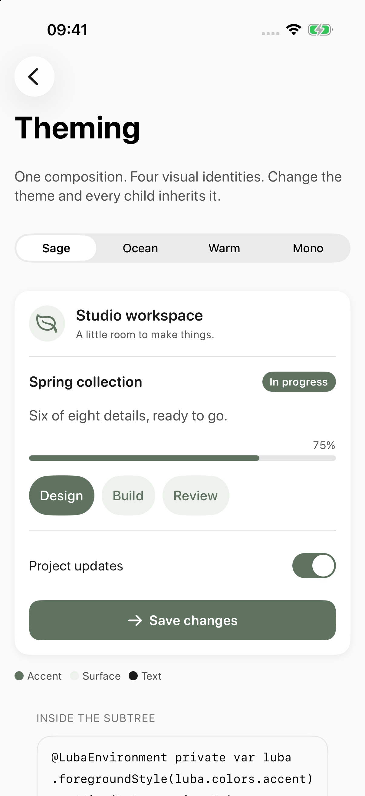
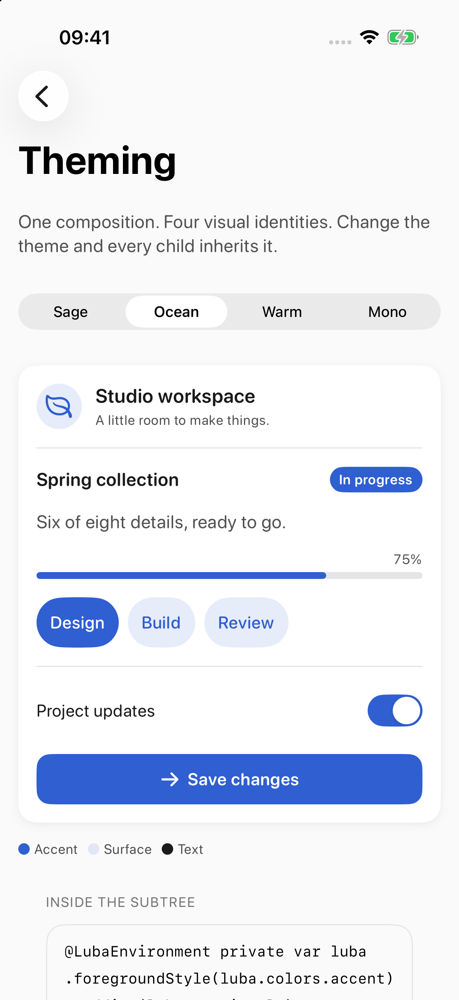
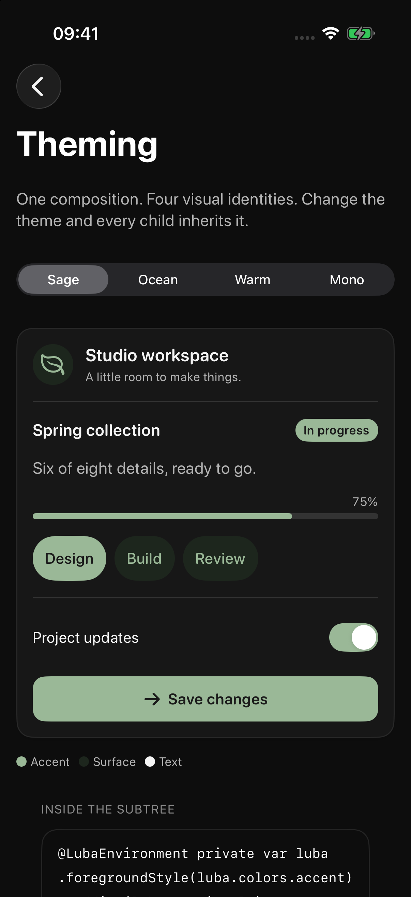
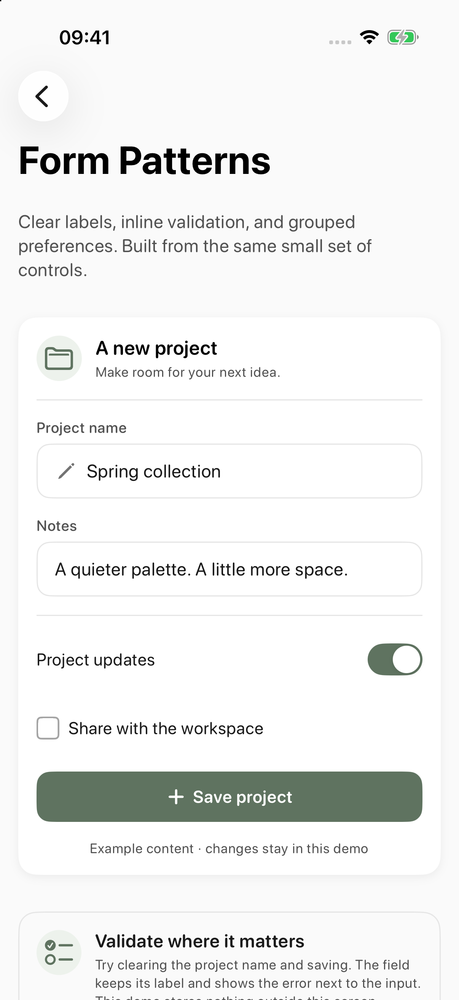
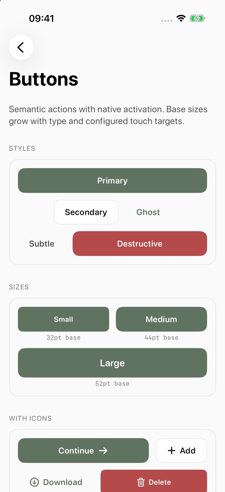
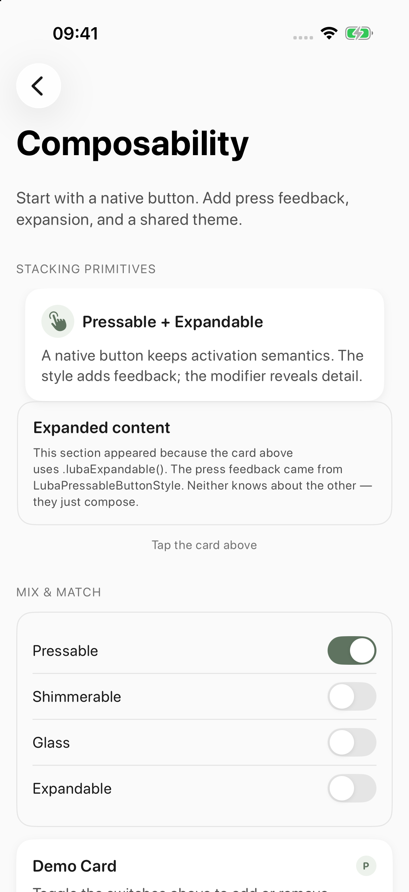
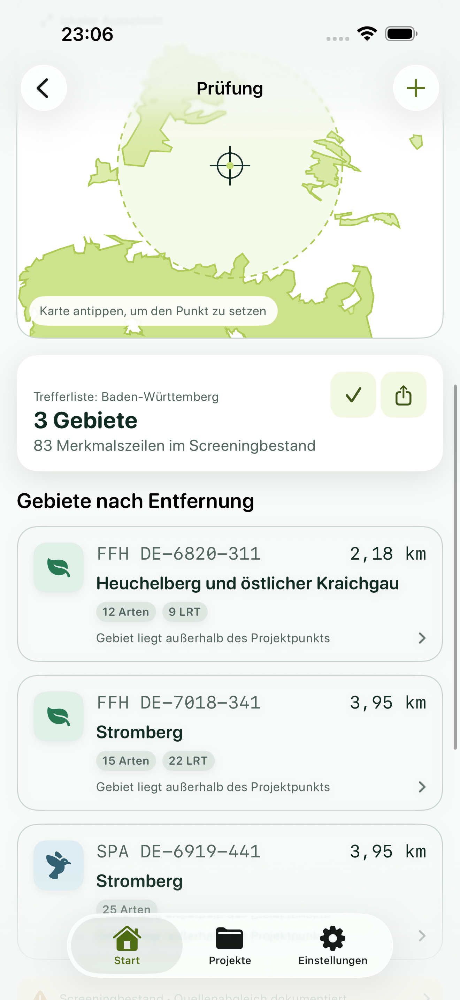
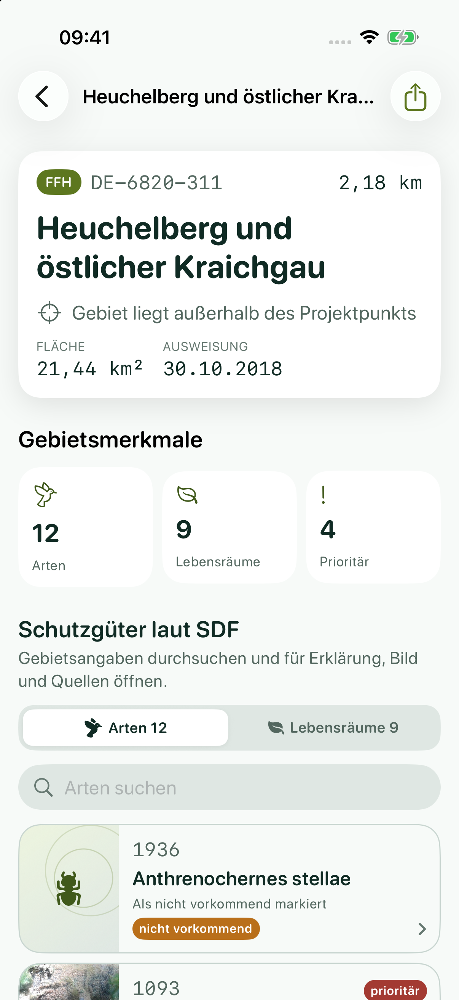
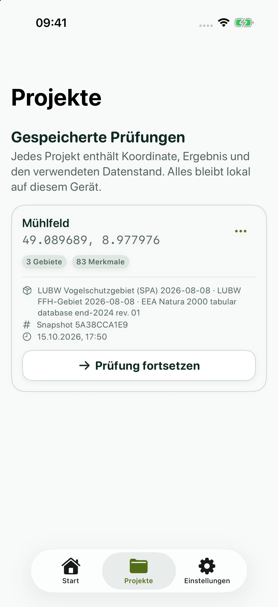
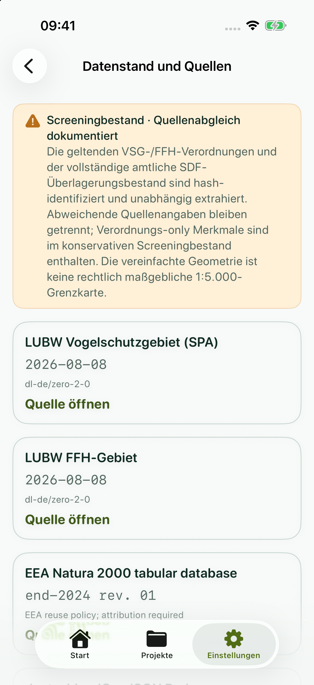

# LubaUI

**A composable SwiftUI design system, used in a shipping iOS app.**

Semantic themes, reusable controls, and interaction primitives for native Apple
interfaces. Give an app its own visual identity while keeping its type, spacing,
colors, and motion consistent.

[Get started](#get-started) · [Guide](docs/Guide.md) · [API documentation](Sources/LubaUI/LubaUI.docc/LubaUI.md) · [Website](https://shopofluba.de/lubaui) · [Releases](https://github.com/ermanakar/LubaUI/releases)

## Explore the showcase

The native showcase runs against **LubaUI 0.3.0**. The same composition in sage,
ocean, and dark mode shows how semantic tokens connect the pieces. Forms and
interaction examples are working demos you can run and inspect.

<table>
  <tr>
    <td width="33%"><a href="assets/showcase/theme-sage.png"></a></td>
    <td width="33%"><a href="assets/showcase/theme-ocean.png"></a></td>
    <td width="33%"><a href="assets/showcase/theme-dark.png"></a></td>
  </tr>
  <tr>
    <td><strong>Shared foundation</strong><br />Cards, chips, progress, and a toggle in one composition.</td>
    <td><strong>Your own identity</strong><br />The same view with an ocean palette and tighter spacing.</td>
    <td><strong>Light to dark</strong><br />Semantic surfaces and text follow the color scheme.</td>
  </tr>
  <tr>
    <td width="33%"><a href="assets/showcase/forms.png"></a></td>
    <td width="33%"><a href="assets/showcase/buttons.png"></a></td>
    <td width="33%"><a href="assets/showcase/composition.png"></a></td>
  </tr>
  <tr>
    <td><strong>Forms that guide</strong><br />Persistent labels, validation, and grouped preferences.</td>
    <td><strong>Everyday controls</strong><br />Semantic styles, configurable targets, and scalable type.</td>
    <td><strong>Behaviors that compose</strong><br />Native activation, press feedback, and expandable detail.</td>
  </tr>
</table>

[Run the showcase](LubaUIShowcase/README.md) · [Capture notes and validation example](assets/showcase/README.md)

## In a complete app

These fresh Wirkraum captures show a custom LubaUI theme in an application with
its own content and navigation. They use the app's existing **0.2.0** integration
and bundled QA examples; the showcase above demonstrates **0.3.0**.

<table>
  <tr>
    <td width="25%"><a href="assets/in-use/results.png"></a></td>
    <td width="25%"><a href="assets/in-use/dossier.png"></a></td>
    <td width="25%"><a href="assets/in-use/projects.png"></a></td>
    <td width="25%"><a href="assets/in-use/sources.png"></a></td>
  </tr>
  <tr>
    <td><strong>Results</strong><br />Repeated cards and badges.</td>
    <td><strong>Detail</strong><br />Tabs, search, and type hierarchy.</td>
    <td><strong>Saved work</strong><br />Supporting details and actions.</td>
    <td><strong>Sources</strong><br />Alerts, information cards, and links.</td>
  </tr>
</table>

[About these application screenshots](assets/in-use/README.md)

## Choose what you need

**0.3.0** separates the foundation from the component catalog.

| Product / import | Includes |
| --- | --- |
| `LubaCore` | Theme, tokens, typography, motion, haptics, localization, and interaction primitives. No component catalog. |
| `LubaComponents` | Ready-made controls and containers, plus Core. |
| `LubaUI` | Convenience import re-exporting Core and Components. Existing non-chart imports keep working. |

Charts are removed from 0.3.0, including their wrappers, styling modifier, and
layout tokens. Use Apple's Swift Charts directly when an app needs visualization.
Existing palette settings remain usable with custom views and keep existing
app themes compiling. There is no `LubaCharts` product.

See the [0.3.0 migration guide](docs/MigratingTo0.3.md) for installation,
product selection, and the explicitly removed APIs.

## Get started

Add the package in Xcode using `https://github.com/ermanakar/LubaUI`, or add it to
your package dependencies:

```swift
.package(url: "https://github.com/ermanakar/LubaUI", from: "0.3.0")
```

Read the [0.3.0 release notes](CHANGELOG.md#030--2026-10-15), especially if you used
the removed chart APIs. Use a tagged version and keep your app’s resolved package
versions under version control for reproducible builds.

```swift
import SwiftUI
import LubaUI

struct SettingsExample: View {
    @LubaEnvironment private var luba
    @State private var name = ""
    @State private var notifications = true

    var body: some View {
        LubaCard {
            VStack(alignment: .leading, spacing: luba.spacing.lg) {
                Text("Preferences")
                    .font(luba.fonts.title)
                    .foregroundStyle(luba.colors.textPrimary)
                LubaTextField("Name", text: $name)
                LubaToggle(isOn: $notifications, label: "Notifications")
            }
        }
        .padding(luba.spacing.xl)
        .lubaTheme(colors: .accented(.indigo))
    }
}
```

The [example source](Examples/SettingsExample.swift) is typechecked in CI.

## What you can build with it

| Layer | Use it for |
| --- | --- |
| **Themes** | Colors, typography, spacing, and radii that resolve from the view environment. |
| **Components** | Buttons, fields, cards, selection controls, alerts, and loading states. |
| **Primitives** | Press feedback, swipe actions, long-press confirmation, expansion, shimmer, and material surfaces. |
| **Motion policy** | Resolve animation against the app configuration and the system Reduce Motion setting. |
| **Localization** | Built-in UI and accessibility strings in English and German. |

Read the [component guide](docs/Guide.md#components) for the catalog and the
[theming guide](docs/Guide.md#theming) to bring your own palette.

### Accessibility in context

Text roles support Dynamic Type, and the motion policy honors Reduce Motion.
Compact chip and tab labels remain on one line and may truncate; check your
actual labels and layouts at accessibility sizes. Interactive screens still need
VoiceOver, keyboard, contrast, and touch-target checks in the app that uses them.
See [release notes](CHANGELOG.md#030--2026-10-15) for the chip and field
fixes after 0.2.0.

For an accessible tappable card, use a native `Button` with
`LubaPressableButtonStyle`. The lower-level `.lubaPressable()` gesture modifier
provides pointer/touch feedback, but does not add native button semantics.

## For coding agents

[llms.txt](llms.txt) documents the theme context, token scales, component APIs,
and motion policy. The [MCP server](mcp-server/README.md) provides lookup,
validation, and migration tools.

Use MCP **1.4.0** with LubaUI **0.3.0**. Its catalog describes the module split,
retired charts, and corrected token guidance. Library and MCP versions are separate;
the MCP README covers both registry installation and running from source.

## Platforms and verification

The package declares iOS 16+, macOS 13+, watchOS 9+, tvOS 16+, and visionOS 1+.
Swift 5.9+ and Xcode 15+ are the package baseline.

CI runs the Swift tests on macOS, builds the iOS Simulator library, typechecks
the example, verifies all three package products with downstream consumers,
and checks the MCP catalog inside its publishable archive. Those
checks do not replace device testing on every declared platform.

## Contributing

Start with [the architecture reference](llms.txt) and [the guide](docs/Guide.md).
Read theme values through `@LubaEnvironment`, route animation through
`luba.motion`, and localize built-in strings in both shipped languages.

```sh
swift test
bash Scripts/check-examples.sh
bash Scripts/check-consumers.sh
cd mcp-server && npm ci && npm test
```

## License

The library is [MIT licensed](LICENSE). Screenshot reuse and embedded third-party
content are described in the [asset notes](assets/in-use/README.md).
